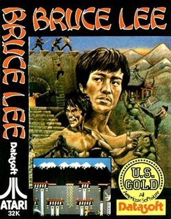
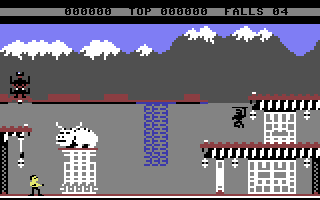
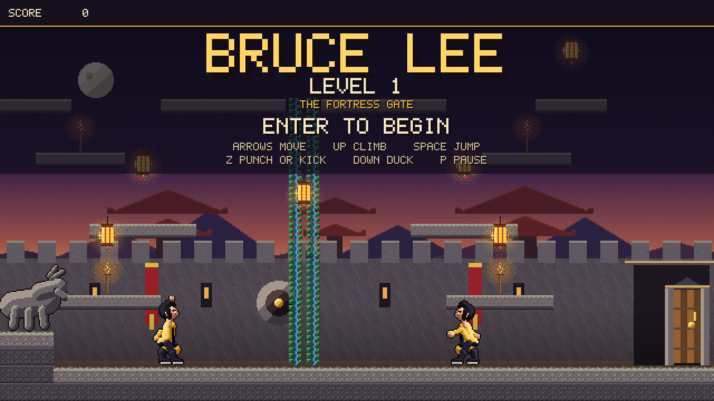
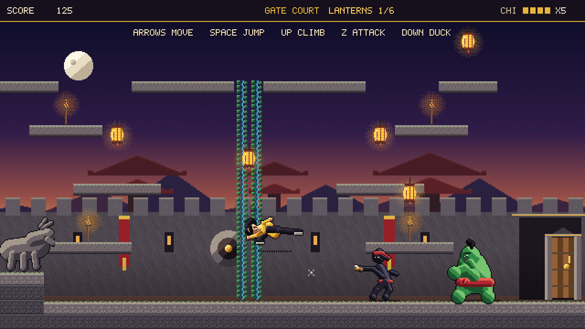
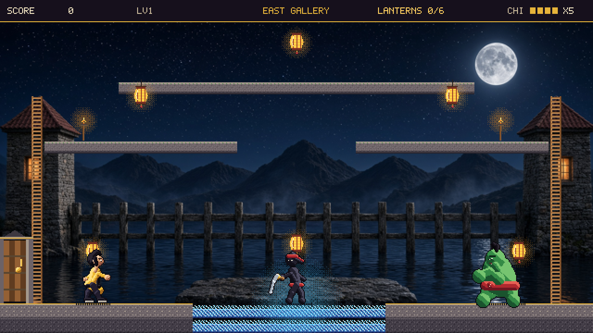
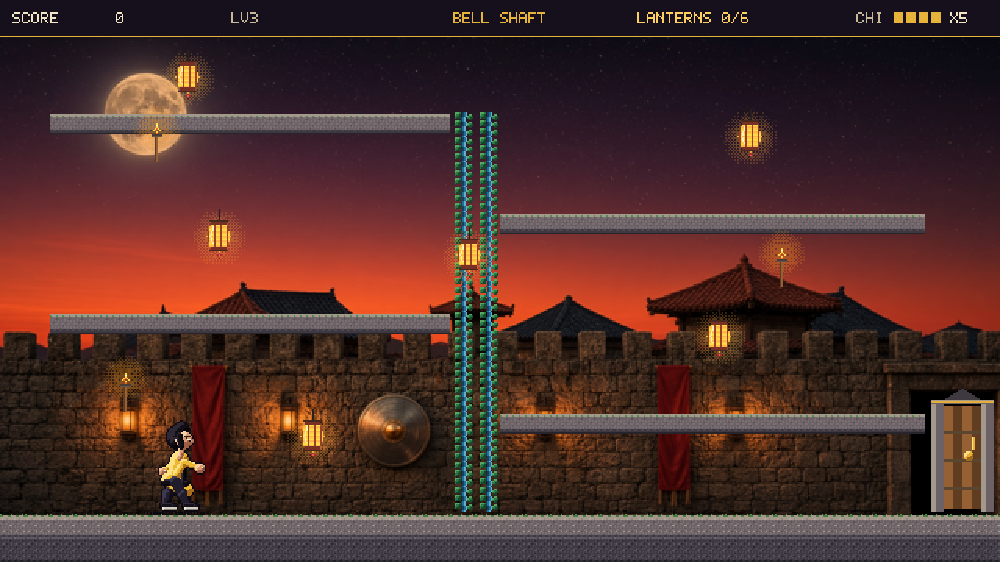
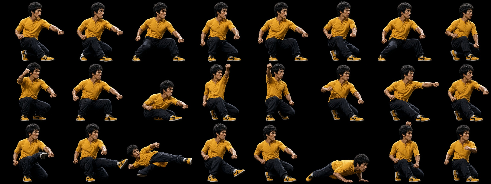
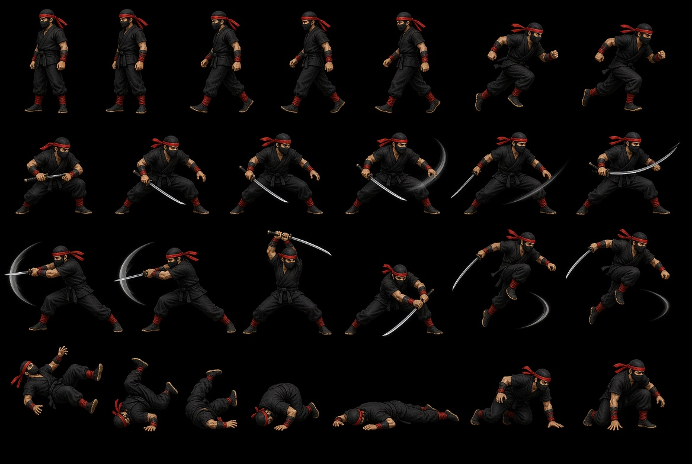
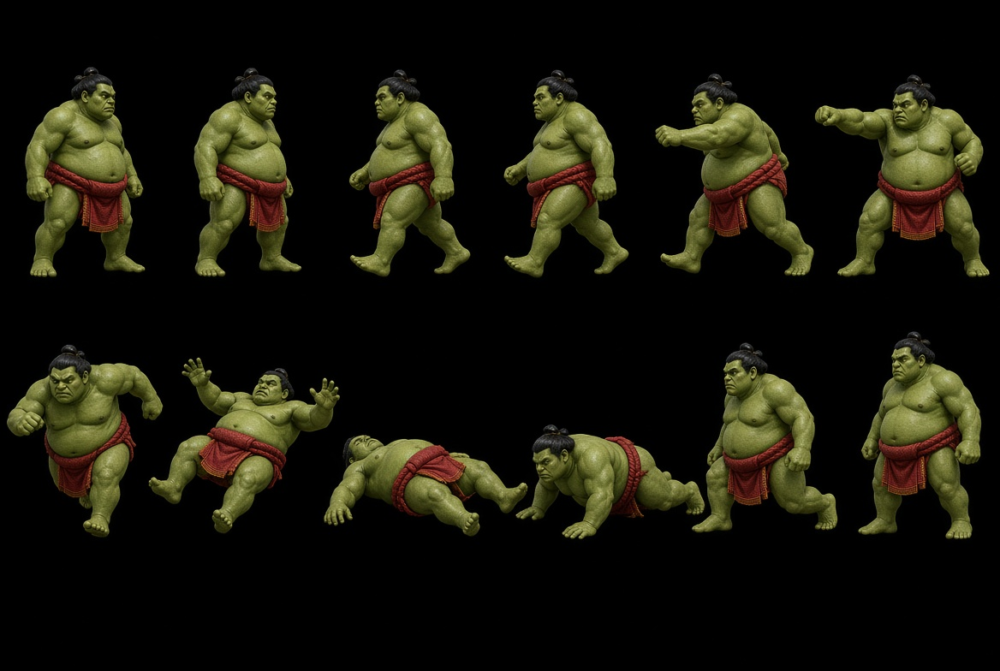

# Bruce Lee

An unofficial pixel-art tribute to Datasoft's 1984 *Bruce Lee*. This build is four fortress levels, three chambers each. The sprites, rooms, and code are original. It is not affiliated with the Bruce Lee estate or with Datasoft.

The desktop game is a Rust binary. Art and synthesized sound are compiled into the executable, so a release build is one file. There is no installer. The same source compiles to WebAssembly for the page in `web/`.

# The Original on C64

Best game ever ! :) 






## Screenshots

Title screen.



A flying kick in the Gate Court. The ninja throws a shuriken. Green Yamo closes in from the right.



The East Gallery. The middle of the floor is electric. Cross while it is dark, or stay on the ladders and the bridge.



The Bell Shaft, on the third level. Platforms alternate off a vine that runs the height of the room.



The same command that plays the game can write every still, including the other levels:

## New sprite sheets to be integrated

### Bruce Lee



### Ninja



### Sumo Fighter




# Early DEMO

Very early buggy version here: https://rust-bruce-lee-st.web.app/


```
cargo run -- --shots
```

That fills `shots/` and does not open a window.

## Requirements

- [Rust](https://rustup.rs/) with `cargo`. This project was built with Rust 1.99 (edition 2021). Any recent stable toolchain is enough.
- A display, for the desktop window (`minifb`).
- [wasm-pack](https://rustwasm.github.io/wasm-pack/installer/), for the browser build, and the `wasm32-unknown-unknown` target (`rustup target add wasm32-unknown-unknown`).

Python is only needed if you regenerate the pixel art. It is not needed to play or to build a release.

## Play

From this folder:

```
cargo run
```

The first run compiles the game and its dependencies. Later runs start quickly.

The window is 1280×720: a 640×360 pixel-art screen, scaled 2× with nearest-neighbor pixels. On a smaller display:

```
cargo run -- --1
```

That opens a 640×360 window. Click the window once so the keys reach the game.

| Key | Action |
| --- | --- |
| Left / Right, or A / D | Run |
| Space | Jump |
| Up or W, on a ladder or vine | Climb |
| Up or W, away from a ladder or vine | Jump |
| Left / Right while climbing | Step off onto a nearby ledge |
| Down or S | Duck. The ninja's saber and shurikens pass overhead. |
| Z, X, J, or K | Punch while standing still. Flying kick while running or in the air. |
| P | Pause. The music pauses with the game. |
| M | Mute or unmute music and effects |
| Enter | Start, or play again after the clear screen or game over |
| Esc | Quit |
| F1 | Toggle a thin debug outline on the player |

## Sound

The music and effects are original and synthesized when the game starts. They are not recordings from the 1984 release, and there are no audio files to copy next to the program.

A looping theme plays on the title screen and another through the chambers. The clear screen and game over each get their own phrase. Effects cover the jump, punch, kick, shuriken, lantern, hit, defeat, electric floor, and a passage opening.

If the computer has no audio device, the game prints a line and keeps running with the sound off.

## Release builds

A release build turns on compiler optimizations. The result is a single program. You do not copy `assets/` next to it.

### Mac

On the Mac you want the game to run on:

```
cd /Users/aselvais/projects/games/rust-bruce-lee-st
cargo build --release
```

The program is:

```
target/release/bruce-lee
```

Run it:

```
./target/release/bruce-lee
```

The same flags work on the release binary:

```
./target/release/bruce-lee --1
./target/release/bruce-lee --shots
```

`--shots` writes the stills in `shots/` and does not open a window. Run it from the project folder so `shots/` is created there.

The binary matches the Mac you compiled on. On this machine that is Apple silicon (`arm64`). An Intel Mac needs its own `cargo build --release` on that Mac. To ship one file that runs on both, build each target and join them:

```
rustup target add aarch64-apple-darwin x86_64-apple-darwin
cargo build --release --target aarch64-apple-darwin
cargo build --release --target x86_64-apple-darwin
mkdir -p dist
lipo -create \
  target/aarch64-apple-darwin/release/bruce-lee \
  target/x86_64-apple-darwin/release/bruce-lee \
  -output dist/bruce-lee
```

`dist/bruce-lee` is the universal Mac binary. A binary downloaded from the internet may be blocked by Gatekeeper until you right-click it and choose Open, or clear the quarantine flag with `xattr -d com.apple.quarantine dist/bruce-lee`. A binary you just compiled locally does not need that.

### PC (Windows)

Build the Windows release on Windows. Install Rust from <https://rustup.rs/> (the default MSVC toolchain), open a terminal in this folder, and run:

```
cargo build --release
```

The program is:

```
target\release\bruce-lee.exe
```

Double-click `bruce-lee.exe`, or from that folder:

```
.\target\release\bruce-lee.exe
.\target\release\bruce-lee.exe --1
```

Copy `bruce-lee.exe` anywhere. It does not need `assets\`, a DLL folder, or the Rust toolchain on the machine that only plays the game.

This repository is developed on macOS. The Windows executable is produced by the command above on a Windows PC. Both releases are the same source and the same embedded art.

### Web

Rust compiles this game to WebAssembly (`wasm32-unknown-unknown`). The page in `web/` draws the same 640×360 framebuffer into a canvas and scales it with nearest-neighbor pixels. Music and effects are the same synthesized clips, played by the Web Audio API. The pictures stay inside the wasm module.

Serve the `web` folder over HTTP. The page fetches the wasm module, which browsers allow from a web server.

One-time setup:

```
rustup target add wasm32-unknown-unknown
cargo install wasm-pack
```

Homebrew works on a Mac: `brew install wasm-pack`.

Build the release:

```
./tools/build_web.sh
```

On Windows, from this folder:

```
rustup target add wasm32-unknown-unknown
wasm-pack build --target web --release --out-dir web/pkg
```

The build writes `web/pkg/bruce_lee.js` and `web/pkg/bruce_lee_bg.wasm` next to `web/index.html` and `web/play.js`. Serve that folder:

```
python3 -m http.server -d web 8080
```

Open <http://127.0.0.1:8080>. Click the page or press a key so the browser allows sound. Enter starts the game. The keys match the table above. The buttons under the picture send the same actions as the keys, so the page can be played without a keyboard.

## The fortress

Four levels. Each level is three single-screen chambers and 18 lanterns. Walk through an open door and the next room slides in. The same door rule is used on every level: the first chamber guards the east door, the middle chamber guards the east door and holds the floor hatch, and the last chamber is a dead end.

Clear every lantern in the level and the hatch in the middle chamber opens. Drop through it. On the first three levels that starts the next level: score, lives, and chi carry over, and you arrive at the lower left of the new gate. The fourth hatch clears the fortress.

1. **The Fortress Gate.** Gate Court, Middle Hall, East Gallery. A guardian statue and a center vine, then side ladders, then a high bridge over a timed electric floor.
2. **The Inner Keep.** West Stair, Keep Hall, East Cistern. A climbing stair and a side ladder, a stack of balconies, then a cistern whose middle floor is electric.
3. **The Bell Tower.** Bell Shaft, Tower Hall, Bell Walk. Platforms alternate off a tall vine, the hall is higher on the right, and the walk has two electric gaps with a safe island between them.
4. **The Throne Vault.** Vault Stairs, Throne Hall, Throne Walk. A rising stair beside a vine, a high hall over the last hatch, then a double electric moat. The hatch here ends the run.

The electric floor runs on a 2.45 second cycle. It is dark, then it flashes a warning, then it is live. Cross while it is dark, or stay on the ladders and the upper platforms. Standing on it while it is live costs one pip of chi.

The black ninja takes two hits. He slashes with a saber up close and throws shurikens from farther away. Duck and both go over you. Green Yamo, the sumo, takes three hits. Both return after a few seconds, and they can hit each other. A shuriken that hits Yamo hurts him. Touching either fighter costs chi. A fall does not.

You have four chi pips and five lives. When chi reaches zero you lose a life and return to the left side of the current room. At zero lives the run ends. Enter starts again.

### Score

| Event | Points |
| --- | --- |
| Lantern | 125 |
| Punch | 100 |
| Flying kick | 75 |
| Stomp (land on an enemy) | 50 |
| Ninja defeated | the hit, plus 200 |
| Green Yamo defeated | the hit, plus 450 |
| First visit to a new chamber | 2000 |
| Level clear, including the final hatch | 2000 |

The HUD shows the score, the level number, the chamber name, lanterns taken in the current room, chi, and lives remaining. The 2000 for a level clear is paid when you drop through the hatch. The first room of a level is not scored as a new chamber.

## Project layout

```
Cargo.toml          package bruce-lee, edition 2021
Cargo.lock          locked dependency versions
src/lib.rs          shared game, used by the desktop binary and the web build
src/main.rs         desktop window loop, keys, screenshot writer
src/web.rs          wasm entry: framebuffer, input, audio clips
src/game.rs         rooms, combat, score, title and clear screens
src/level.rs        four levels, physics, doors, hatch, electric floor
src/gfx.rs          framebuffer, sprite blit, pixel font
src/audio.rs        synthesized music and effects
web/index.html      browser page
web/play.js         canvas, keys, buttons, Web Audio
web/pkg/            release wasm from tools/build_web.sh
assets/             PNG sprites and the three room backgrounds
tools/gen_assets.py redraws the PNGs in assets/
tools/build_web.sh  builds the browser release
shots/              stills from --shots
LICENSE             MIT, Copyright (c) 2026 Arnaud Selvais
```

Internal resolution is 640×360. The top 24 rows are the HUD. The playfield is 40×21 tiles of 16 pixels (336 pixels tall).

Sprites and backgrounds are loaded with `include_bytes!` in `src/gfx.rs`. Changing a PNG requires a rebuild before the game shows it.

To redraw the art (Python 3 and Pillow):

```
python3 tools/gen_assets.py
cargo build
```

## Tests

```
cargo test
```

The tests check that a fall lands on the court floor, that a jump clears a one-way ledge, that every lantern in all four levels can be reached from the left spawn, that each hall hatch is solid until the lanterns are taken, and that the synthesized music and effects stay in an audible range.

## Dependencies

| Crate | Use |
| --- | --- |
| `minifb` 0.27 | Desktop window, keyboard, 60 fps |
| `image` 0.25 | PNG decode for embedded art, and writing `--shots` |
| `rodio` 0.22 | Desktop playback of the synthesized music and effects |
| `wasm-bindgen` 0.2 | Browser build only. Exports the game to the page |
| `console_error_panic_hook` 0.1 | Browser build only. Prints Rust panics in the developer console |

Cargo fetches them. `minifb` and `rodio` are compiled for the desktop binary and left out of the wasm build. No system libraries need a separate install on macOS or on Windows with the default Rustup toolchain. The browser build also needs `wasm-pack`, which runs the matching `wasm-bindgen` CLI.
